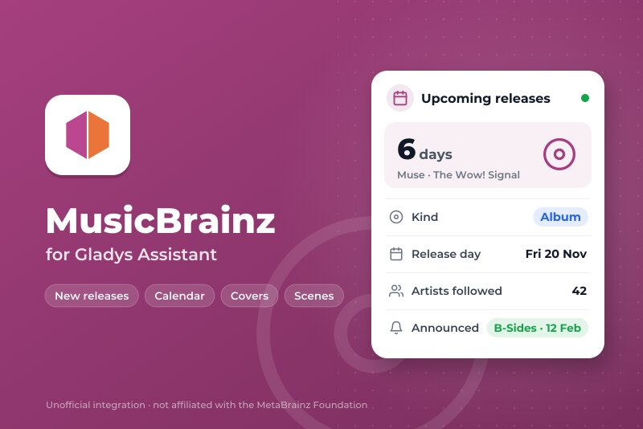
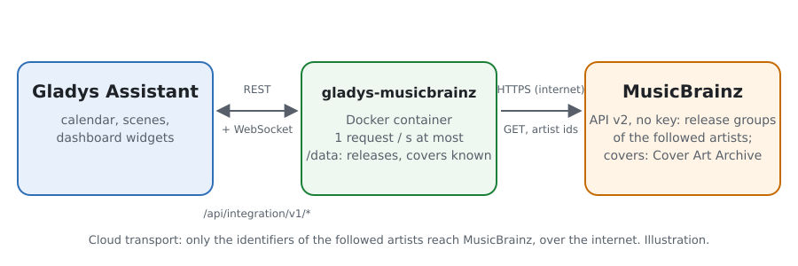
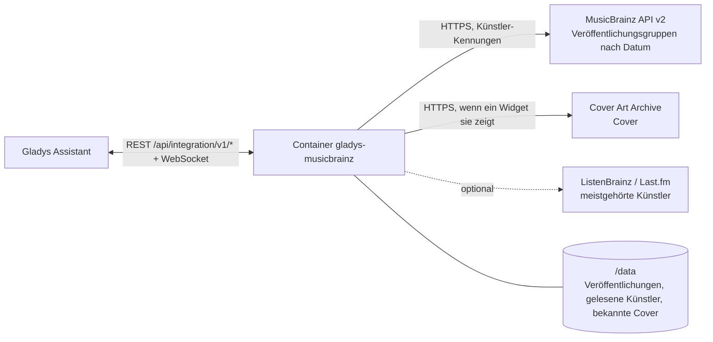
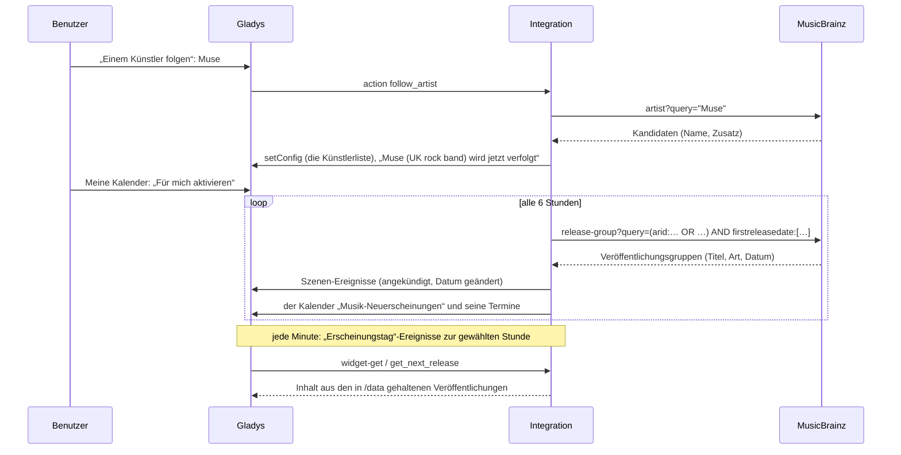
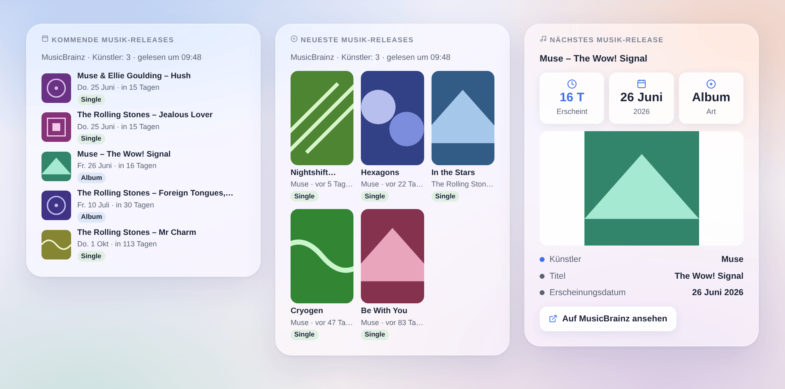

# Gladys MusicBrainz

[English](README.md) · [Français](README.fr.md) · **Deutsch** · [Español](README.es.md)

[](LICENSE)
[](https://github.com/William-De71/gladys-musicbrainz/releases)
[](https://github.com/William-De71/gladys-musicbrainz/actions/workflows/release.yml)
[](https://gladysassistant.com)



Eine externe Integration für [Gladys Assistant](https://gladysassistant.com), die **die Neuerscheinungen Ihrer Lieblingskünstler** verfolgt: Alben, EPs und Singles, die auf [MusicBrainz](https://musicbrainz.org) angekündigt sind, landen im Gladys-Kalender. Szenen können Sie benachrichtigen, wenn eine Platte angekündigt wird oder erscheint, und drei Dashboard-Widgets zeigen samt Cover, was kommt.

Benutzerdokumentation: [English](docs/en.md) · [Français](docs/fr.md) · [Deutsch](docs/de.md) · [Español](docs/es.md).

> Community-Integration, weder mit der MetaBrainz Foundation (MusicBrainz, ListenBrainz, Cover Art Archive) noch mit Last.fm verbunden oder von ihnen unterstützt.

## Funktionen

- **Die Veröffentlichungen der Künstler, denen Sie folgen**, über die offizielle MusicBrainz-API: kein Konto, kein Schlüssel. Standardmäßig Alben und EPs; Singles, Live-Alben, Compilations und Sonstige lassen sich hinzufügen. Bootlegs und Neuauflagen erscheinen nie.
- **Vier Wege, die Künstler zu wählen**, die sich ergänzen (höchstens 300): die Schaltfläche „Einem Künstler folgen“ (ein Name genügt), eine öffentliche **MusicBrainz-Sammlung** und die meistgehörten Künstler eines **ListenBrainz**- oder **Last.fm**-Profils.
- **Ein Kalender „Musik-Neuerscheinungen“** für jeden Benutzer, der die Integration in „Meine Kalender“ aktiviert: ein ganztägiger Termin pro Veröffentlichung, deren Tag bekannt ist.
- **3 Szenen-Auslöser**, **2 Szenenaktionen**, **3 Dashboard-Widgets** und **4 Konfigurations-Schaltflächen** (siehe unten).
- **Cover** aus dem Cover Art Archive, nur angezeigt, wenn eines existiert.
- Überall vier Sprachen: Englisch, Französisch, Deutsch, Spanisch.

## Funktionsweise





[MusicBrainz](https://musicbrainz.org) ist eine offene Musik-Enzyklopädie, von ihrer Community gepflegt und von der MetaBrainz Foundation betrieben. Eine Platte ist dort eine **Veröffentlichungsgruppe** („release group“), unabhängig von ihren Ausgaben; ihr erstes Veröffentlichungsdatum ist der Tag, an dem sie erscheint, sodass eine Neuauflage nie als neu zählt.

Alle 6 Stunden (3 bis 24) sucht die Integration die Veröffentlichungsgruppen der verfolgten Künstler, die in den letzten 100 Tagen erschienen sind oder noch erscheinen, **20 Künstler pro Anfrage**, höchstens eine Anfrage pro Sekunde, wie MusicBrainz es verlangt. 100 Künstler sind 5 Anfragen. Antwortet MusicBrainz mit „überlastet“, wird die Anfrage wiederholt, dann pausiert das Lesen fünf Minuten; ein fehlgeschlagener Lesevorgang entfernt nichts.

Was ein Lesevorgang ändert, löst die Szenen-Auslöser aus; danach werden die Kalender veröffentlicht und die Cover der Veröffentlichungen gesucht, die ein Widget zeigen kann. Der erste Lesevorgang eines Künstlers ist der Ausgangsstand: Fünfzig Künstlern zu folgen kündigt nichts an.



### Transport

Nur Cloud (`"transports": ["cloud"]`): Der Katalog zeigt das Cloud-Abzeichen. Die Kennungen der verfolgten Künstler gehen an `musicbrainz.org`; die Cover werden von `coverartarchive.org` (das auf `archive.org` weiterleitet) geladen, wenn ein Dashboard sie zeigt; ein ListenBrainz- oder Last.fm-Benutzername geht nur an diesen Dienst, wenn er angegeben ist. Sonst verlässt nichts über Sie oder Ihr Zuhause Ihr Netzwerk. Es gibt keinen lokalen Weg, daher auch keine Schaltfläche „Lokale Verbindung bevorzugen“.

## Kalender und Termine

Keine Geräte: Gladys lässt eine Integration nicht zugleich Kalender- und Geräte-Integration sein.

| Element      | Inhalt                                                                                         |
| ------------ | ---------------------------------------------------------------------------------------------- |
| Kalender     | „Musik-Neuerscheinungen“ (EN „Music releases“), einer pro Benutzer, privat, bis Sie ihn teilen |
| Termin       | Ganztägig, am ersten Veröffentlichungsdatum, nur wenn der Tag bekannt ist                      |
| Titel        | Credit und Titel: „Muse – The Wow! Signal“                                                     |
| Beschreibung | Die Art (Album, EP, Single …) und die Quelle                                                   |
| Link         | Die Seite der Veröffentlichungsgruppe auf MusicBrainz                                          |

Das Fenster reicht von 30 Tagen zurück bis zwei Jahre voraus. In „Meine Kalender“ kann jeder Benutzer die Synchronisierung des Kalenders beenden oder ihn **mit dem Haushalt teilen**: Nur ein geteilter Kalender erreicht die Szenen des Haushalts und den nativen Auslöser „Kalenderereignis steht bevor“. Die verfolgten Künstler sind für alle Benutzer dieselben.

## Szenen-Auslöser, Aktionen und Widgets



**Szenen-Auslöser** (einmal pro Übergang). Filter: Arten von Veröffentlichungen, Name des Künstlers.

- **Veröffentlichung angekündigt**: Eine neue Veröffentlichung eines verfolgten Künstlers ist auf MusicBrainz erschienen (nie beim ersten Lesen eines Künstlers, höchstens 10 pro Lesevorgang).
- **Erscheinungstag**: Eine Veröffentlichung erscheint heute, morgen oder in einer Woche (Filter „Wann“), zur Stunde der Konfiguration. Nur wenn der Tag bekannt ist.
- **Erscheinungsdatum geändert**: verschoben, vorgezogen oder präzisiert (`previous_date`).

Die Variablen: `full_title`, `title`, `artist`, `credit`, `kind`, `kind_name`, `date`, `date_text`, `days`, `url`, `cover_url`, `text`, `release_id` (sowie `lead`, `previous_date`, `previous_date_text`).

**Szenenaktionen**: **nächste Veröffentlichung** und **neueste Veröffentlichung** (bestimmter Arten oder eines Künstlers): Titel, Künstler, Art, Datum, Tage, Link, Cover-Adresse und ein fertiger Satz („Muse – The Wow! Signal (Album) erscheint in 6 Tagen, am 20 Nov 2026.“).

**Widgets**: **Kommende Musik-Releases** (Liste mit Datum, Abzeichen der Art und Cover), **Neueste Musik-Releases** (Cover-Raster) und **Nächstes Musik-Release** (Countdown und großes Cover). Einstellungen: Arten von Veröffentlichungen, Anzahl der angezeigten Veröffentlichungen, Zeitraum.

**Konfigurations-Schaltflächen**: einem Künstler folgen, einem Künstler nicht mehr folgen, verfolgte Künstler auflisten, jetzt neu lesen.

Beispiele:

- Wenn **ein Album eines verfolgten Künstlers heute erscheint** → `{{triggerEvent.data.text}}` per Telegram senden.
- Wenn **eine Veröffentlichung angekündigt wird** → `{{triggerEvent.data.full_title}}, {{triggerEvent.data.date_text}}` senden.
- Jeden Freitag um 18 Uhr → **die neueste Veröffentlichung abrufen** und Gladys `{{text}}` sagen lassen.

## Voraussetzungen

- Gladys Assistant **5.3.0** oder neuer (Kalender-Integrationen; Katalog-Schlagwörter von Gladys 5.3). Ältere Instanzen können die Integration nicht installieren.
- Internetzugang. Kein Konto; eine MusicBrainz-Sammlung, ein ListenBrainz-Profil oder ein Last.fm-API-Schlüssel sind optional.

## Installation

- **Aus dem Gladys-Store** (Integrationen → Externe Integrationen), mit einem Klick, sobald sie indexiert ist.
- **Über die URL des Repositorys**: `https://github.com/William-De71/gladys-musicbrainz`.
- **Entwicklermodus**: das Image lokal bauen (`docker build -t gladys-musicbrainz .`) und aus Gladys installieren.

## Konfiguration

| Feld                                   | Beschreibung                                                                         |
| -------------------------------------- | ------------------------------------------------------------------------------------ |
| Arten von Veröffentlichungen           | Standardmäßig Alben und EPs; Singles, Live-Alben, Compilations, Sonstige.            |
| MusicBrainz-Sammlung                   | Adresse einer öffentlichen Künstlersammlung (optional), einmal täglich neu gelesen.  |
| ListenBrainz-Benutzername              | Folgt Ihren meistgehörten Künstlern (optional, kein Schlüssel).                      |
| Last.fm-Benutzername / -API-Schlüssel  | Folgt Ihren meistgehörten Künstlern (optional; der Schlüssel ist ein geheimes Feld). |
| Verfolgte meistgehörte Künstler        | 10, 20 (Standard), 30 oder 50.                                                       |
| Hörzeitraum                            | Das Jahr oder seit Beginn.                                                           |
| Lesen von MusicBrainz                  | Alle 3, 6 (Standard), 12 oder 24 Stunden.                                            |
| Stunde des Auslösers „Erscheinungstag“ | 0 bis 23, Ortszeit (Standard: 9).                                                    |
| Sprache der Szenentexte                | Automatisch (die Sprache des Dashboards) oder eine feste Sprache.                    |

Die per Schaltfläche verfolgten Künstler werden in der Konfiguration von Gladys gespeichert (sie sind Teil der Gladys-Backups). Drücken Sie anschließend in **Meine Kalender** auf derselben Seite auf **Für mich aktivieren**: Jeder Benutzer, der den Kalender möchte, aktiviert die Integration für sich selbst.

## Verwendung

1. Folgen Sie Künstlern mit der Schaltfläche **Einem Künstler folgen** und/oder geben Sie eine Quelle an, dann speichern Sie.
2. Drücken Sie in **Meine Kalender** auf **Für mich aktivieren**; teilen Sie den Kalender mit dem Haushalt, um ihn in Szenen zu nutzen.
3. Fügen Sie die Widgets einem Dashboard hinzu und erstellen Sie Szenen mit den Auslösern oben.

## Entwicklung

```bash
npm install
npm test                       # node --test, berührt nie das Netzwerk
npm run lint && npm run format:check
npx github:GladysAssistant/integration-store . --skip-image-check
scripts/build-cover.sh         # cover.jpg aus docs/assets/cover.svg
docs/illustrations/render.sh   # docs/assets/widgets.<lang>.png
node .github/scripts/release.mjs next
```

Lokal liest das SDK `GLADYS_HOST_API_URL`, `GLADYS_INTEGRATION_TOKEN` und `GLADYS_INTEGRATION_SELECTOR`, und `TZ` legt die Zeitzone der Tage fest; `DEBUG=gladys-integration-sdk` gibt die SDK-Protokolle aus und prüft jeden Widget-Inhalt. Die Tests verwenden echte, gekürzte Antworten von MusicBrainz und ListenBrainz (`test/fixtures/`). Die Regeln des Projekts stehen in [CLAUDE.md](CLAUDE.md).

## Release-Prozess


Jeder Merge auf `main` startet die CI und berechnet dann die Version aus den [Conventional Commits](https://www.conventionalcommits.org/) seit dem letzten Tag: `feat` → Minor, `fix` / `perf` → Patch, `!` oder `BREAKING CHANGE` → Major (vor 1.0.0 ein Minor); `docs`, `chore`, `ci`, `test`, `style`, `refactor`, `build` allein veröffentlichen nichts. Der Changelog-Abschnitt wird erzeugt, der Tag gepusht, das Multi-Arch-Image gebaut, dann erhält `main` den Release-Commit, das GitHub Release wird erstellt und ein letzter Job prüft das öffentliche Image, den Store-Validator und das Topic.

- Der Titel des Pull Requests wird zum Squash-Commit und dann zur Changelog-Zeile: Schreiben Sie ihn auf Englisch, für den Benutzer (`pr-title.yml` prüft ihn). Bearbeiten Sie `CHANGELOG.md` nie von Hand.
- 1.0.0 ist eine Entscheidung: Actions → Release → Run workflow mit `release-as: 1.0.0`. `dry-run` zeigt die Version und die Notizen, ohne etwas zu veröffentlichen.
- **Geschützter Branch**: Das Release pusht seinen Commit mit `GITHUB_TOKEN` auf `main`. Bei einem Ruleset auf `main` fügen Sie GitHub Actions zu dessen Bypass-Liste hinzu (oder pushen über eine GitHub App), sonst schlägt der Veröffentlichungs-Job mit Hinweisen fehl.
- Machen Sie nach dem ersten Release das `ghcr.io`-Paket öffentlich (Package settings → Change visibility), sonst kann Gladys es nicht herunterladen.

## Fehlerbehebung

Siehe [docs/de.md](docs/de.md#fehlerbehebung). Melden Sie Probleme mit den Versionen von Gladys und der Integration, den genutzten Künstlerquellen und den Zeilen des Tabs Protokolle.

## Mitwirken

Issues und Pull Requests sind willkommen. Führen Sie `npm run format:check && npm run lint && npm test` aus, bevor Sie einen Pull Request öffnen, und lassen Sie jede externe Kennung und jeden gespeicherten Schlüssel unverändert (siehe [CLAUDE.md](CLAUDE.md)). Eine falsche oder fehlende Veröffentlichung wird an der Quelle korrigiert, auf musicbrainz.org.

## Sicherheit

Siehe [SECURITY.md](SECURITY.md): Melden Sie Schwachstellen vertraulich. Der Last.fm-API-Schlüssel ist ein geheimes Feld und wird nie in die Protokolle geschrieben; die Integration läuft schreibgeschützt, ohne Root-Rechte, in ihrem Container und kontaktiert nur MusicBrainz, das Cover Art Archive und den von Ihnen konfigurierten Hördienst.

## Geplante Screenshots

Die Bilder oben sind Illustrationen, keine Screenshots. Echte Screenshots kommen nach `docs/assets/screenshots/` (PNG, 1280 × 800): `configuration.png`, `my-calendars.png`, `calendar.png`, `scene.png`.

## Lizenz

[Apache-Lizenz 2.0](LICENSE) — siehe auch [NOTICE](NOTICE). Die Veröffentlichungen stammen von [MusicBrainz](https://musicbrainz.org) (Kerndaten gemeinfrei, CC0) und die Cover aus dem [Cover Art Archive](https://coverartarchive.org); sie gehören ihren Eigentümern. Dank an die MetaBrainz Foundation und ihre Community sowie an die Dokumentation und das SDK von Gladys.
