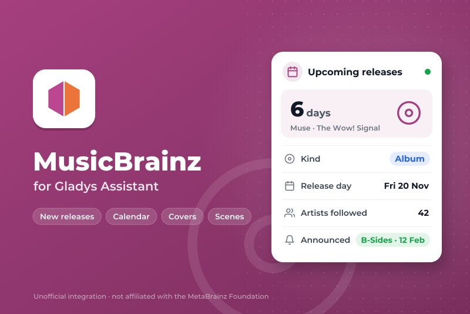
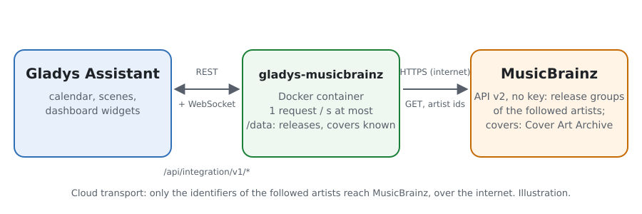
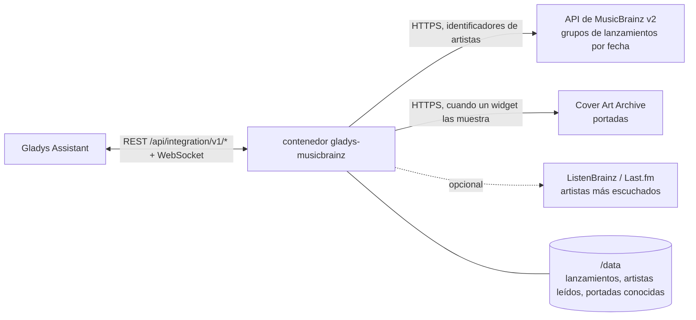
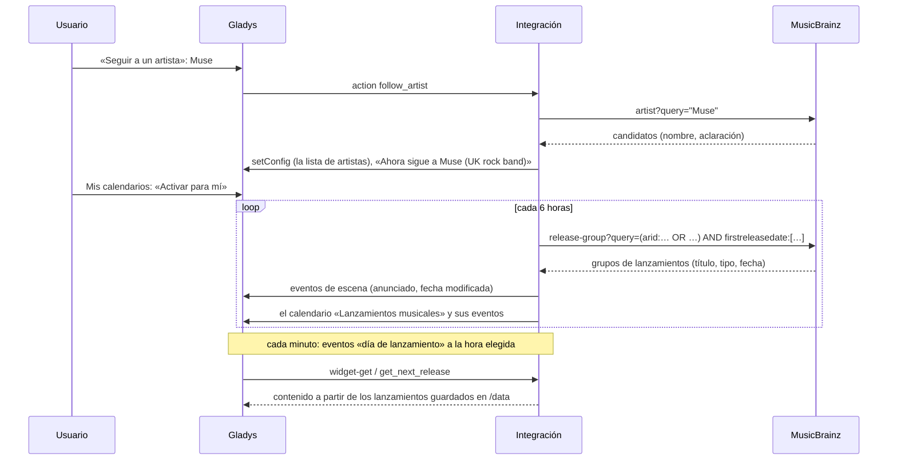
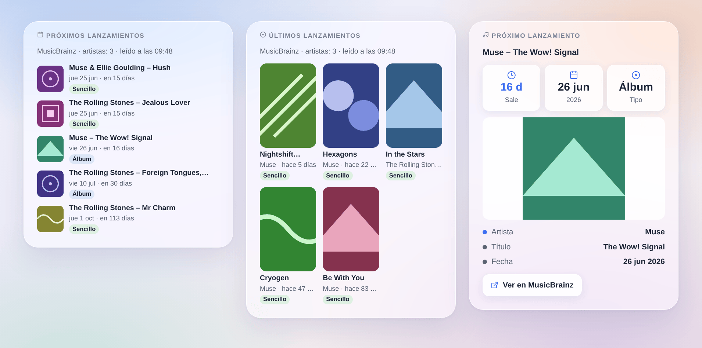

# Gladys MusicBrainz

[English](README.md) · [Français](README.fr.md) · [Deutsch](README.de.md) · **Español**

[](LICENSE)
[](https://github.com/William-De71/gladys-musicbrainz/releases)
[](https://github.com/William-De71/gladys-musicbrainz/actions/workflows/release.yml)
[](https://gladysassistant.com)



Una integración externa de [Gladys Assistant](https://gladysassistant.com) que sigue **los nuevos lanzamientos de sus artistas favoritos**: los álbumes, EP y sencillos anunciados en [MusicBrainz](https://musicbrainz.org) llegan al calendario de Gladys. Las escenas pueden avisarle cuando un disco se anuncia o sale, y tres widgets del panel muestran lo que viene, con las portadas.

Documentación de usuario: [English](docs/en.md) · [Français](docs/fr.md) · [Deutsch](docs/de.md) · [Español](docs/es.md).

> Integración comunitaria, sin relación con la MetaBrainz Foundation (MusicBrainz, ListenBrainz, Cover Art Archive) ni con Last.fm, y no respaldada por ellas.

## Funciones

- **Los lanzamientos de los artistas que sigue**, mediante la API oficial de MusicBrainz: sin cuenta ni clave. Álbumes y EP por defecto; se pueden añadir sencillos, álbumes en directo, recopilatorios y otros. Los bootlegs y las reediciones nunca aparecen.
- **Cuatro maneras de elegir los artistas**, que se suman (300 como máximo): un botón «Seguir a un artista» (basta un nombre), una **colección de MusicBrainz** pública y los artistas más escuchados de un perfil de **ListenBrainz** o de **Last.fm**.
- **Un calendario «Lanzamientos musicales»** para cada usuario que activa la integración en «Mis calendarios»: un evento de día completo por cada lanzamiento cuyo día está anunciado.
- **3 disparadores de escena**, **2 acciones de escena**, **3 widgets del panel** y **4 botones de configuración** (más abajo).
- **Portadas** de Cover Art Archive, mostradas solo cuando existe una.
- Cuatro idiomas en todas partes: inglés, francés, alemán, español.

## Cómo funciona





[MusicBrainz](https://musicbrainz.org) es una enciclopedia libre de la música, editada por su comunidad y gestionada por la MetaBrainz Foundation. Allí un disco es un **grupo de lanzamientos** («release group»), sean cuales sean sus ediciones; su primera fecha de publicación es el día en que sale, de modo que una reedición nunca cuenta como novedad.

Cada 6 horas (de 3 a 24), la integración busca los grupos de lanzamientos de los artistas seguidos publicados en los últimos 100 días o por publicar, **20 artistas por petición**, una petición por segundo como máximo, como pide MusicBrainz. 100 artistas son 5 peticiones. Cuando MusicBrainz responde «saturado», la petición se reintenta y después la lectura se detiene cinco minutos; una lectura fallida no elimina nada.

Lo que cambia una lectura lanza los disparadores de escena; después se publican los calendarios y se buscan las portadas de los lanzamientos que un widget puede mostrar. La primera lectura de un artista es el punto de partida: seguir a cincuenta artistas no anuncia nada.



### Transporte

Solo nube (`"transports": ["cloud"]`): el catálogo muestra la insignia de nube. Los identificadores de los artistas seguidos van a `musicbrainz.org`; las portadas se descargan de `coverartarchive.org` (que redirige a `archive.org`) cuando un panel las muestra; un usuario de ListenBrainz o de Last.fm solo va a ese servicio, cuando se indica. Nada más sobre usted o su hogar sale de su red. No hay vía local, por lo que tampoco hay botón «Preferir la conexión local».

## Calendario y eventos

Sin dispositivos: Gladys no permite que una integración sea a la vez de tipo calendario y de tipo dispositivo.

| Elemento    | Contenido                                                                                      |
| ----------- | ---------------------------------------------------------------------------------------------- |
| Calendario  | «Lanzamientos musicales» (EN «Music releases»), uno por usuario, privado hasta que lo comparta |
| Evento      | De día completo, en la primera fecha de publicación, solo cuando se conoce el día              |
| Título      | El crédito y el título: «Muse – The Wow! Signal»                                               |
| Descripción | El tipo (álbum, EP, sencillo…) y la fuente                                                     |
| Enlace      | La página del grupo de lanzamientos en MusicBrainz                                             |

La ventana va de 30 días atrás a dos años por delante. En «Mis calendarios», cada usuario puede dejar de sincronizar el calendario o **compartirlo con el hogar**: solo un calendario compartido llega a las escenas del hogar y al disparador nativo «Se acerca un evento del calendario». Los artistas seguidos son los mismos para todos los usuarios.

## Disparadores de escena, acciones y widgets



**Disparadores de escena** (una vez por transición). Filtros: tipos de lanzamientos, nombre del artista.

- **Lanzamiento anunciado**: ha aparecido en MusicBrainz un nuevo lanzamiento de un artista seguido (nunca en la primera lectura de un artista, 10 como máximo por lectura).
- **Día de lanzamiento**: un lanzamiento sale hoy, mañana o dentro de una semana (filtro «Cuándo»), a la hora de la configuración. Solo cuando se conoce el día.
- **Fecha de lanzamiento modificada**: aplazada, adelantada o precisada (`previous_date`).

Las variables: `full_title`, `title`, `artist`, `credit`, `kind`, `kind_name`, `date`, `date_text`, `days`, `url`, `cover_url`, `text`, `release_id` (y `lead`, `previous_date`, `previous_date_text`).

**Acciones de escena**: **próximo lanzamiento** y **último lanzamiento** (de ciertos tipos, o de un artista): título, artista, tipo, fecha, días, enlace, dirección de la portada y una frase hecha («Muse – The Wow! Signal (Álbum) sale en 6 días, el 20 nov 2026.»).

**Widgets**: **Próximos lanzamientos** (lista con fecha, insignia del tipo y portada), **Últimos lanzamientos** (cuadrícula de portadas) y **Próximo lanzamiento** (cuenta atrás y portada grande). Ajustes: tipos de lanzamientos, número de lanzamientos mostrados, periodo.

**Botones de configuración**: seguir a un artista, dejar de seguir a un artista, listar los artistas seguidos, volver a leer ahora.

Ejemplos:

- Cuando **un álbum de un artista seguido sale hoy** → enviar `{{triggerEvent.data.text}}` por Telegram.
- Cuando **se anuncia un lanzamiento** → enviar `{{triggerEvent.data.full_title}}, {{triggerEvent.data.date_text}}`.
- Cada viernes a las 18:00 → **obtener el último lanzamiento** y hacer que Gladys diga `{{text}}`.

## Requisitos

- Gladys Assistant **5.3.0** o posterior (integraciones de calendario; palabras clave del catálogo de Gladys 5.3). Las instancias más antiguas no pueden instalar la integración.
- Acceso a internet. Sin cuenta; una colección de MusicBrainz, un perfil de ListenBrainz o una clave de API de Last.fm son opcionales.

## Instalación

- **Desde la tienda de Gladys** (Integraciones → Integraciones externas), en un clic, una vez indexada.
- **Desde la URL del repositorio**: `https://github.com/William-De71/gladys-musicbrainz`.
- **Modo desarrollador**: construir la imagen en local (`docker build -t gladys-musicbrainz .`) e instalarla desde Gladys.

## Configuración

| Campo                                    | Descripción                                                                        |
| ---------------------------------------- | ---------------------------------------------------------------------------------- |
| Tipos de lanzamientos                    | Álbumes y EP por defecto; sencillos, álbumes en directo, recopilatorios, otros.    |
| Colección de MusicBrainz                 | Dirección de una colección pública de artistas (opcional), releída una vez al día. |
| Usuario de ListenBrainz                  | Sigue a sus artistas más escuchados (opcional, sin clave).                         |
| Usuario / clave de API de Last.fm        | Sigue a sus artistas más escuchados (opcional; la clave es un campo secreto).      |
| Artistas más escuchados seguidos         | 10, 20 (por defecto), 30 o 50.                                                     |
| Periodo de escucha                       | El año, o desde el principio.                                                      |
| Lectura de MusicBrainz                   | Cada 3, 6 (por defecto), 12 o 24 horas.                                            |
| Hora del disparador «día de lanzamiento» | De 0 a 23, hora local (9 por defecto).                                             |
| Idioma de los textos de las escenas      | Automático (el idioma del panel), o un idioma fijo.                                |

Los artistas seguidos con el botón se guardan en la configuración de Gladys (forman parte de sus copias de seguridad). Después, en **Mis calendarios** en la misma página, pulse **Activar para mí**: cada usuario que quiera el calendario activa la integración para sí mismo.

## Uso

1. Siga a artistas con el botón **Seguir a un artista** y/o indique una fuente, y guarde.
2. En **Mis calendarios**, pulse **Activar para mí**; comparta el calendario con el hogar para usarlo en las escenas.
3. Añada los widgets a un panel y cree escenas con los disparadores anteriores.

## Desarrollo

```bash
npm install
npm test                       # node --test, nunca toca la red
npm run lint && npm run format:check
npx github:GladysAssistant/integration-store . --skip-image-check
scripts/build-cover.sh         # cover.jpg a partir de docs/assets/cover.svg
docs/illustrations/render.sh   # docs/assets/widgets.<lang>.png
node .github/scripts/release.mjs next
```

En local, el SDK lee `GLADYS_HOST_API_URL`, `GLADYS_INTEGRATION_TOKEN` y `GLADYS_INTEGRATION_SELECTOR`, y `TZ` fija la zona horaria de los días; `DEBUG=gladys-integration-sdk` muestra los registros del SDK y comprueba cada contenido de widget. Las pruebas usan respuestas reales de MusicBrainz y de ListenBrainz, reducidas (`test/fixtures/`). Las reglas del proyecto están en [CLAUDE.md](CLAUDE.md).

## Proceso de publicación


Cada fusión en `main` ejecuta la CI y después calcula la versión a partir de los [Conventional Commits](https://www.conventionalcommits.org/) desde la última etiqueta: `feat` → menor, `fix` / `perf` → parche, `!` o `BREAKING CHANGE` → mayor (una menor antes de la 1.0.0); `docs`, `chore`, `ci`, `test`, `style`, `refactor`, `build` por sí solos no publican nada. Se genera la sección del changelog, se envía la etiqueta, se construye la imagen multiarquitectura, luego `main` recibe el commit de publicación, se crea la GitHub Release y un último trabajo comprueba la imagen pública, el validador de la tienda y el topic.

- El título de la pull request se convierte en el commit de squash y después en la línea del changelog: escríbalo en inglés, para el usuario (`pr-title.yml` lo comprueba). No edite nunca `CHANGELOG.md` a mano.
- La 1.0.0 es una decisión: Actions → Release → Run workflow con `release-as: 1.0.0`. `dry-run` muestra la versión y las notas sin publicar nada.
- **Rama protegida**: unos rulesets exigen una pull request en `main` y bloquean las etiquetas `v*`; solo pasan el mantenedor y las deploy keys. La publicación hace push con la deploy key del entorno `release` (secreto `RELEASE_DEPLOY_KEY`, solo `main`): una ejecución lanzada desde otra rama nunca la obtiene. `build.yml` y `github-release.yml` no arrancan con una etiqueta: la publicación los llama, o lánzelos a mano (Actions → Run workflow, con `version` para la imagen) para terminar una publicación.
- Tras la primera publicación, haga público el paquete de `ghcr.io` (Package settings → Change visibility); de lo contrario, Gladys no puede descargarlo.

## Solución de problemas

Véase [docs/es.md](docs/es.md#solución-de-problemas). Comunique los problemas con las versiones de Gladys y de la integración, las fuentes de artistas utilizadas y las líneas de la pestaña Registros.

## Contribuir

Las issues y las pull requests son bienvenidas. Ejecute `npm run format:check && npm run lint && npm test` antes de abrir una pull request y no cambie ningún identificador externo ni ninguna clave almacenada (véase [CLAUDE.md](CLAUDE.md)). Un lanzamiento erróneo o ausente se corrige en origen, en musicbrainz.org.

## Seguridad

Véase [SECURITY.md](SECURITY.md): comunique las vulnerabilidades en privado. La clave de API de Last.fm es un campo secreto que nunca se escribe en los registros; la integración se ejecuta en solo lectura, sin privilegios de root, en su contenedor, y solo contacta con MusicBrainz, Cover Art Archive y el servicio de escucha que haya configurado.

## Capturas de pantalla pendientes

Las imágenes anteriores son ilustraciones, no capturas de pantalla. Las capturas reales irán en `docs/assets/screenshots/` (PNG, 1280 × 800): `configuration.png`, `my-calendars.png`, `calendar.png`, `scene.png`.

## Licencia

[Licencia Apache 2.0](LICENSE) — véase también [NOTICE](NOTICE). Los lanzamientos proceden de [MusicBrainz](https://musicbrainz.org) (datos básicos en el dominio público, CC0) y las portadas de [Cover Art Archive](https://coverartarchive.org); pertenecen a sus propietarios. Gracias a la MetaBrainz Foundation y a su comunidad, así como a la documentación y al SDK de Gladys.
