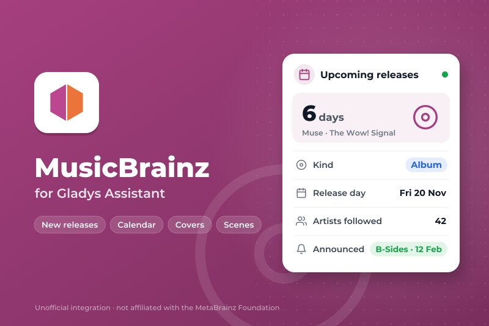
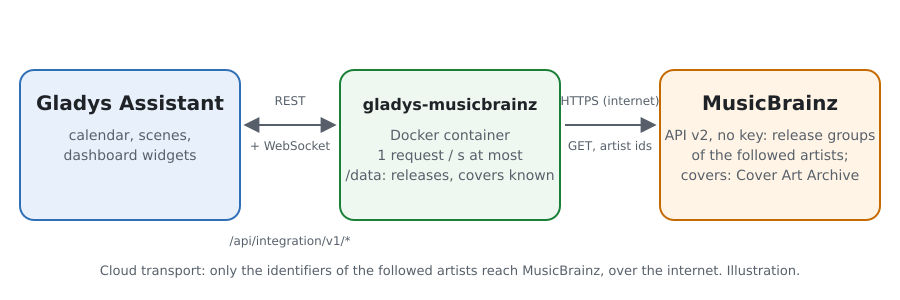
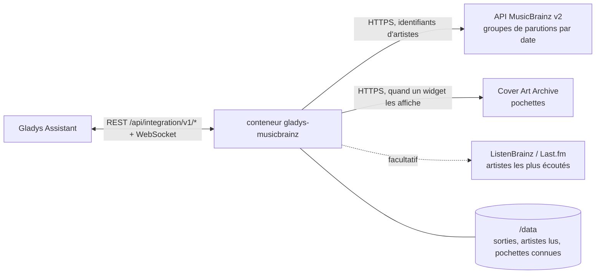
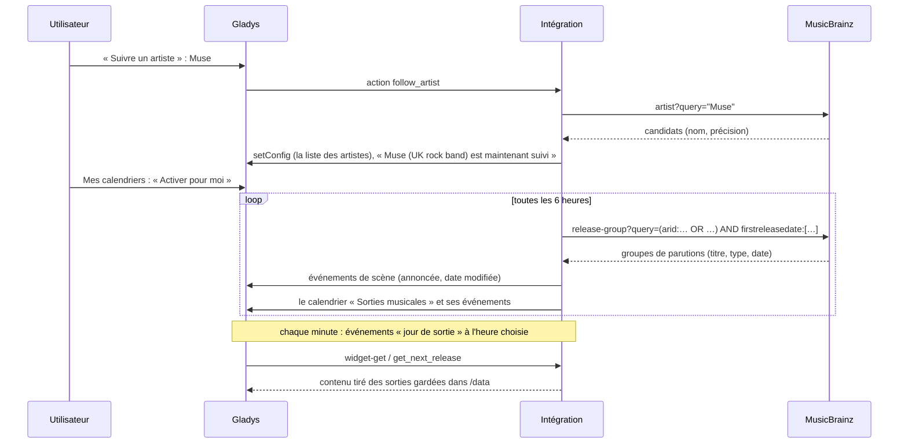
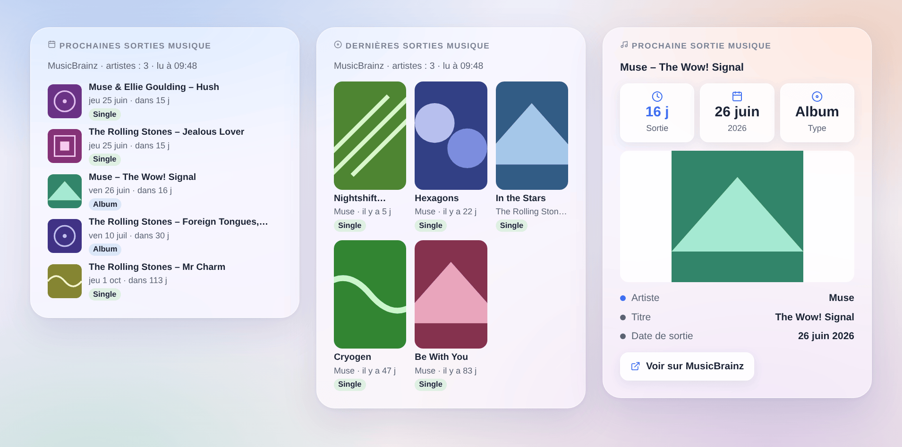

# Gladys MusicBrainz

[English](README.md) · **Français** · [Deutsch](README.de.md) · [Español](README.es.md)

[](LICENSE)
[](https://github.com/William-De71/gladys-musicbrainz/releases)
[](https://github.com/William-De71/gladys-musicbrainz/actions/workflows/release.yml)
[](https://gladysassistant.com)



Une intégration externe [Gladys Assistant](https://gladysassistant.com) qui suit **les nouvelles sorties de vos artistes préférés** : les albums, EP et singles annoncés sur [MusicBrainz](https://musicbrainz.org) arrivent dans le calendrier de Gladys. Les scènes peuvent vous prévenir quand un disque est annoncé ou sort, et trois widgets de tableau de bord montrent ce qui arrive, avec les pochettes.

Documentation utilisateur : [English](docs/en.md) · [Français](docs/fr.md) · [Deutsch](docs/de.md) · [Español](docs/es.md).

> Intégration communautaire, sans lien avec la MetaBrainz Foundation (MusicBrainz, ListenBrainz, Cover Art Archive) ni avec Last.fm, et non approuvée par elles.

## Fonctionnalités

- **Les sorties des artistes que vous suivez**, par l’API officielle de MusicBrainz : ni compte ni clé. Albums et EP par défaut ; singles, albums live, compilations et autres peuvent être ajoutés. Les bootlegs et les rééditions n’apparaissent jamais.
- **Quatre façons de choisir les artistes**, qui se cumulent (300 au maximum) : un bouton « Suivre un artiste » (un nom suffit), une **collection MusicBrainz** publique, et les artistes les plus écoutés d’un profil **ListenBrainz** ou **Last.fm**.
- **Un calendrier « Sorties musicales »** pour chaque utilisateur qui active l’intégration dans « Mes calendriers » : un événement d’une journée par sortie dont le jour est annoncé.
- **3 déclencheurs de scène**, **2 actions de scène**, **3 widgets de tableau de bord** et **4 boutons de configuration** (ci-dessous).
- **Les pochettes** de la Cover Art Archive, affichées seulement quand il en existe une.
- Quatre langues partout : anglais, français, allemand, espagnol.

## Fonctionnement





[MusicBrainz](https://musicbrainz.org) est une encyclopédie libre de la musique, rédigée par sa communauté et gérée par la MetaBrainz Foundation. Un disque y est un **groupe de parutions** (« release group »), quelles que soient ses éditions ; sa première date de parution est le jour de sa sortie, si bien qu’une réédition ne compte jamais comme une nouveauté.

Toutes les 6 heures (de 3 à 24), l’intégration cherche les groupes de parutions des artistes suivis sortis depuis 100 jours ou à venir, **20 artistes par requête**, une requête par seconde au plus comme le demande MusicBrainz. 100 artistes font 5 requêtes. Quand MusicBrainz répond « surchargé », la requête est retentée, puis la lecture s’interrompt cinq minutes ; une lecture en échec ne supprime rien.

Ce qu’une lecture change lance les déclencheurs de scène, puis les calendriers sont publiés et les pochettes des sorties qu’un widget peut afficher sont recherchées. La première lecture d’un artiste sert de point de départ : suivre cinquante artistes n’annonce rien.



### Transport

Cloud uniquement (`"transports": ["cloud"]`) : le catalogue affiche le badge cloud. Les identifiants des artistes suivis partent vers `musicbrainz.org` ; les pochettes sont téléchargées depuis `coverartarchive.org` (qui redirige vers `archive.org`) quand un tableau de bord les affiche ; un nom d’utilisateur ListenBrainz ou Last.fm ne part que vers ce service, quand il est renseigné. Rien d’autre sur vous ou votre maison ne quitte votre réseau. Il n’y a pas de chemin local, donc pas de bouton « Préférer la connexion locale ».

## Calendrier et événements

Pas d’appareils : Gladys ne permet pas à une intégration d’être à la fois de type calendrier et de type appareil.

| Élément     | Contenu                                                                                                   |
| ----------- | --------------------------------------------------------------------------------------------------------- |
| Calendrier  | « Sorties musicales » (EN « Music releases »), un par utilisateur, privé tant que vous ne le partagez pas |
| Événement   | Sur la journée, à la première date de parution, seulement quand le jour est connu                         |
| Titre       | Le crédit et le titre : « Muse – The Wow! Signal »                                                        |
| Description | Le type (album, EP, single…) et la source                                                                 |
| Lien        | La page du groupe de parutions sur MusicBrainz                                                            |

La fenêtre va de 30 jours en arrière à deux ans en avant. Dans « Mes calendriers », chaque utilisateur peut cesser de synchroniser le calendrier ou le **partager avec le foyer** : seul un calendrier partagé atteint les scènes du foyer et le déclencheur natif « Un évènement dans le calendrier arrive ». Les artistes suivis sont les mêmes pour tous les utilisateurs.

## Déclencheurs de scène, actions et widgets



**Déclencheurs de scène** (une fois par transition). Filtres : types de sorties, nom de l’artiste.

- **Sortie annoncée** : une nouvelle sortie d’un artiste suivi est apparue sur MusicBrainz (jamais à la première lecture d’un artiste, 10 au plus par lecture).
- **Jour de sortie** : une sortie a lieu aujourd’hui, demain ou dans une semaine (filtre « Quand »), à l’heure de la configuration. Seulement quand le jour est connu.
- **Date de sortie modifiée** : repoussée, avancée ou précisée (`previous_date`).

Les variables : `full_title`, `title`, `artist`, `credit`, `kind`, `kind_name`, `date`, `date_text`, `days`, `url`, `cover_url`, `text`, `release_id` (et `lead`, `previous_date`, `previous_date_text`).

**Actions de scène** : **prochaine sortie** et **dernière sortie** (de certains types, ou d’un artiste) : titre, artiste, type, date, jours, lien, adresse de la pochette et une phrase toute faite (« Muse – The Wow! Signal (Album) sort dans 6 jours, le 20 nov 2026. »).

**Widgets** : **Prochaines sorties musique** (liste avec date, badge du type et pochette), **Dernières sorties musique** (grille de pochettes) et **Prochaine sortie musique** (compte à rebours et grande pochette). Réglages : types de sorties, nombre de sorties listées, période.

**Boutons de configuration** : suivre un artiste, ne plus suivre un artiste, lister les artistes suivis, relire maintenant.

Exemples :

- Quand **un album d’un artiste suivi sort aujourd’hui** → envoyer `{{triggerEvent.data.text}}` sur Telegram.
- Quand **une sortie est annoncée** → envoyer `{{triggerEvent.data.full_title}}, {{triggerEvent.data.date_text}}`.
- Chaque vendredi à 18 h → **lire la dernière sortie** et faire dire `{{text}}` à Gladys.

## Prérequis

- Gladys Assistant **5.3.0** ou plus récent (intégrations de type calendrier ; mots-clés du catalogue de Gladys 5.3). Les instances plus anciennes ne peuvent pas installer l’intégration.
- Un accès à Internet. Aucun compte ; une collection MusicBrainz, un profil ListenBrainz ou une clé d’API Last.fm sont facultatifs.

## Installation

- **Depuis le store de Gladys** (Intégrations → Intégrations externes), en un clic, une fois l’intégration indexée.
- **Depuis l’URL du dépôt** : `https://github.com/William-De71/gladys-musicbrainz`.
- **Mode développeur** : construire l’image en local (`docker build -t gladys-musicbrainz .`) et l’installer depuis Gladys.

## Configuration

| Champ                                   | Description                                                                         |
| --------------------------------------- | ----------------------------------------------------------------------------------- |
| Types de sorties                        | Albums et EP par défaut ; singles, albums live, compilations, autres.               |
| Collection MusicBrainz                  | Adresse d’une collection publique d’artistes (facultatif), relue une fois par jour. |
| Nom d’utilisateur ListenBrainz          | Suit vos artistes les plus écoutés (facultatif, sans clé).                          |
| Nom d’utilisateur / clé d’API Last.fm   | Suit vos artistes les plus écoutés (facultatif ; la clé est un champ secret).       |
| Artistes les plus écoutés suivis        | 10, 20 (par défaut), 30 ou 50.                                                      |
| Période d’écoute                        | L’année, ou depuis le début.                                                        |
| Lecture de MusicBrainz                  | Toutes les 3, 6 (par défaut), 12 ou 24 heures.                                      |
| Heure du déclencheur « jour de sortie » | De 0 à 23, heure locale (9 par défaut).                                             |
| Langue des textes des scènes            | Automatique (la langue du tableau de bord), ou une langue fixe.                     |

Les artistes suivis avec le bouton sont conservés dans la configuration de Gladys (ils suivent ses sauvegardes). Ensuite, dans **Mes calendriers** sur la même page, appuyez sur **Activer pour moi** : chaque utilisateur qui veut le calendrier active l’intégration pour lui-même.

## Utilisation

1. Suivez des artistes avec le bouton **Suivre un artiste**, et/ou renseignez une source, puis enregistrez.
2. Dans **Mes calendriers**, appuyez sur **Activer pour moi** ; partagez le calendrier avec le foyer pour l’utiliser dans les scènes.
3. Ajoutez les widgets à un tableau de bord, et créez des scènes avec les déclencheurs ci-dessus.

## Développement

```bash
npm install
npm test                       # node --test, ne touche jamais le réseau
npm run lint && npm run format:check
npx github:GladysAssistant/integration-store . --skip-image-check
scripts/build-cover.sh         # cover.jpg depuis docs/assets/cover.svg
docs/illustrations/render.sh   # docs/assets/widgets.<lang>.png
node .github/scripts/release.mjs next
```

En local, le SDK lit `GLADYS_HOST_API_URL`, `GLADYS_INTEGRATION_TOKEN` et `GLADYS_INTEGRATION_SELECTOR`, et `TZ` fixe le fuseau horaire des jours ; `DEBUG=gladys-integration-sdk` affiche les journaux du SDK et vérifie chaque contenu de widget. Les tests utilisent de vraies réponses de MusicBrainz et de ListenBrainz, réduites (`test/fixtures/`). Les règles du projet sont dans [CLAUDE.md](CLAUDE.md).

## Processus de release


Chaque fusion sur `main` lance la CI, puis calcule la version à partir des [Conventional Commits](https://www.conventionalcommits.org/) depuis le dernier tag : `feat` → mineure, `fix` / `perf` → corrective, `!` ou `BREAKING CHANGE` → majeure (une mineure avant la 1.0.0) ; `docs`, `chore`, `ci`, `test`, `style`, `refactor`, `build` seuls ne publient rien. La section du changelog est générée, le tag poussé, l’image multi-architecture construite, puis `main` reçoit le commit de release, la GitHub Release est créée et un dernier job vérifie l’image publique, le validateur du store et le topic.

- Le titre de la pull request devient le commit de squash, puis la ligne du changelog : écrivez-le en anglais, pour l’utilisateur (`pr-title.yml` le vérifie). N’éditez jamais `CHANGELOG.md` à la main.
- La 1.0.0 est une décision : Actions → Release → Run workflow avec `release-as: 1.0.0`. `dry-run` affiche la version et les notes sans rien publier.
- **Branche protégée** : la release pousse son commit sur `main` avec `GITHUB_TOKEN`. Avec un ruleset sur `main`, ajoutez GitHub Actions à sa liste de contournement (ou poussez par une GitHub App), sinon le job de publication échoue avec des instructions.
- Après la première release, rendez le package `ghcr.io` public (Package settings → Change visibility), sinon Gladys ne peut pas le télécharger.

## Dépannage

Voir [docs/fr.md](docs/fr.md#dépannage). Signalez les problèmes avec les versions de Gladys et de l’intégration, les sources d’artistes utilisées et les lignes de l’onglet Journaux.

## Contribuer

Les issues et les pull requests sont les bienvenues. Lancez `npm run format:check && npm run lint && npm test` avant d’ouvrir une pull request, et ne changez aucun identifiant externe ni aucune clé stockée (voir [CLAUDE.md](CLAUDE.md)). Une sortie fausse ou manquante se corrige à la source, sur musicbrainz.org.

## Sécurité

Voir [SECURITY.md](SECURITY.md) : signalez les vulnérabilités en privé. La clé d’API Last.fm est un champ secret, jamais écrit dans les journaux ; l’intégration tourne en lecture seule, sans droits root, dans son conteneur, et ne contacte que MusicBrainz, la Cover Art Archive et le service d’écoute que vous avez configuré.

## Captures d’écran à venir

Les images ci-dessus sont des illustrations, pas des captures d’écran. Les vraies captures iront dans `docs/assets/screenshots/` (PNG, 1280 × 800) : `configuration.png`, `my-calendars.png`, `calendar.png`, `scene.png`.

## Licence

[Licence Apache 2.0](LICENSE) — voir aussi [NOTICE](NOTICE). Les sorties viennent de [MusicBrainz](https://musicbrainz.org) (données de base dans le domaine public, CC0) et les pochettes de la [Cover Art Archive](https://coverartarchive.org) ; elles appartiennent à leurs propriétaires. Merci à la MetaBrainz Foundation et à sa communauté, ainsi qu’à la documentation et au SDK de Gladys.
