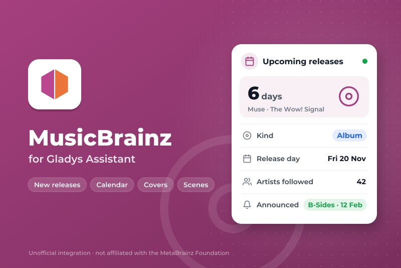
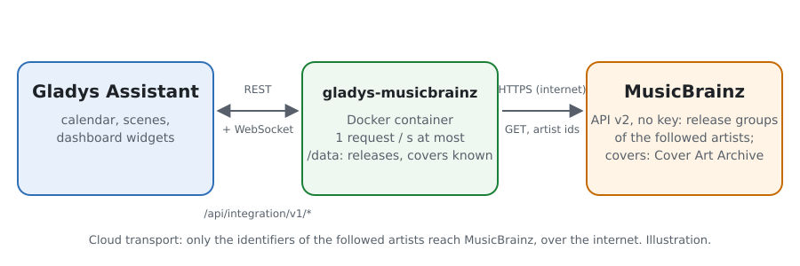
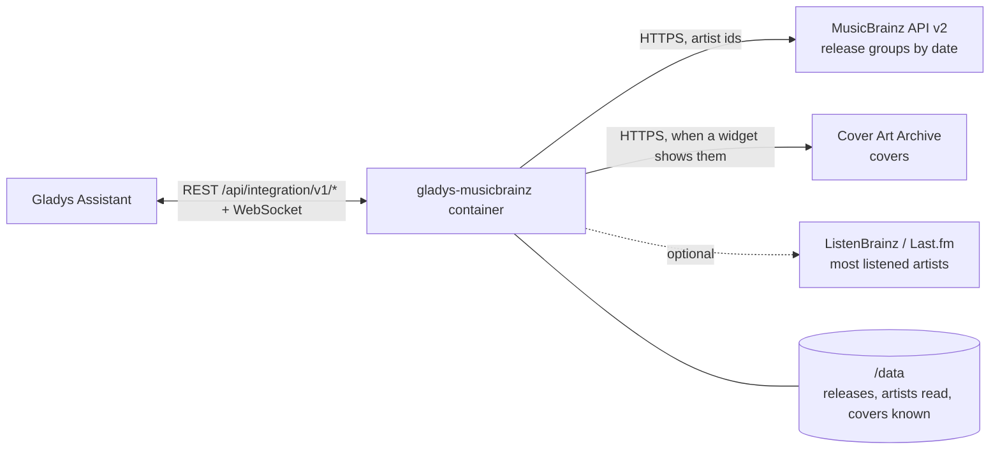
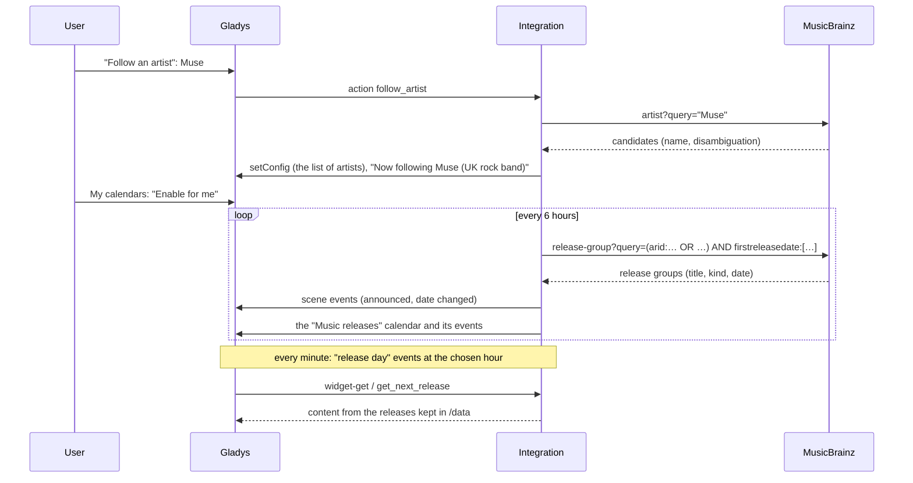
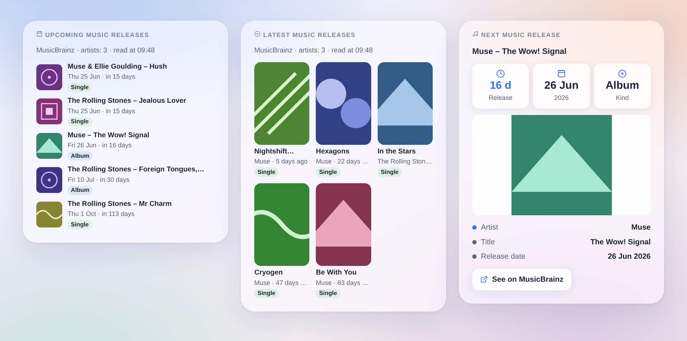

# Gladys MusicBrainz

**English** · [Français](README.fr.md) · [Deutsch](README.de.md) · [Español](README.es.md)

[](LICENSE)
[](https://github.com/William-De71/gladys-musicbrainz/releases)
[](https://github.com/William-De71/gladys-musicbrainz/actions/workflows/release.yml)
[](https://gladysassistant.com)



A [Gladys Assistant](https://gladysassistant.com) external integration that follows **the new releases of your favourite artists**: albums, EPs and singles announced on [MusicBrainz](https://musicbrainz.org) land in the Gladys calendar. Scenes can tell you when a record is announced or comes out, and three dashboard widgets show what is coming, with the covers.

User documentation: [English](docs/en.md) · [Français](docs/fr.md) · [Deutsch](docs/de.md) · [Español](docs/es.md).

> Community integration, not affiliated with or endorsed by the MetaBrainz Foundation (MusicBrainz, ListenBrainz, Cover Art Archive) or Last.fm.

## Features

- **The releases of the artists you follow**, from the official MusicBrainz API: no account, no key. Albums and EPs by default; singles, live albums, compilations and others can be added. Bootlegs and reissues never show.
- **Four ways to choose the artists**, which add up (300 at most): a "Follow an artist" button (a name is enough), a public **MusicBrainz collection**, and the most listened artists of a **ListenBrainz** or **Last.fm** profile.
- **A "Music releases" calendar** for every user who enables the integration in "My calendars": one all-day event per release whose day is announced.
- **3 scene triggers**, **2 scene actions**, **3 dashboard widgets** and **4 configuration buttons** (below).
- **Covers** from the Cover Art Archive, shown only when one exists.
- Four languages everywhere: English, French, German, Spanish.

## How it works





[MusicBrainz](https://musicbrainz.org) is an open music encyclopedia, edited by its community and run by the MetaBrainz Foundation. A record is a **release group** there, whatever its editions; its first release date is the day it comes out, so a reissue never counts as new.

Every 6 hours (3 to 24), the integration searches the release groups of the followed artists first released in the last 100 days or later, **20 artists per request**, one request per second at most as MusicBrainz asks. 100 artists are 5 requests. When MusicBrainz answers "busy", the request is tried again, then the reading pauses for five minutes; a failed reading removes nothing.

What a reading changes fires the scene triggers, then the calendars are published and the covers of the releases a widget can show are looked up. The first reading of an artist is a baseline: following fifty artists announces nothing.



### Transport

Cloud only (`"transports": ["cloud"]`): the catalog shows the cloud badge. The identifiers of the followed artists go to `musicbrainz.org`; the covers are downloaded from `coverartarchive.org` (which redirects to `archive.org`) when a dashboard shows them; a ListenBrainz or Last.fm user name only goes to that service, when it is filled in. Nothing else about you or your home leaves your network. There is no local path, hence no "Prefer the local connection" button.

## Calendar and events

No devices: Gladys does not let one integration be both a calendar and a device integration.

| Item        | Content                                                                             |
| ----------- | ----------------------------------------------------------------------------------- |
| Calendar    | "Music releases" (FR "Sorties musicales"), one per user, private until you share it |
| Event       | All-day, on the first release date, only when the day is known                      |
| Title       | The credit and the title: "Muse – The Wow! Signal"                                  |
| Description | The kind (album, EP, single…) and the source                                        |
| Link        | The page of the release group on MusicBrainz                                        |

The window goes from 30 days back to two years ahead. In "My calendars", each user can stop synchronizing the calendar or **share it with the household**: only a shared calendar reaches the scenes of the household and the native "Calendar event is coming" trigger. The followed artists are the same for every user.

## Scene triggers, actions and widgets



**Scene triggers** (once per transition). Filters: kinds of releases, name of the artist.

- **Release announced**: a new release of a followed artist appeared on MusicBrainz (never at the first reading of an artist, 10 at most per reading).
- **Release day**: a release comes out today, tomorrow or in a week (filter "When"), at the hour of the configuration. Only when the day is known.
- **Release date changed**: postponed, brought forward or made precise (`previous_date`).

The variables: `full_title`, `title`, `artist`, `credit`, `kind`, `kind_name`, `date`, `date_text`, `days`, `url`, `cover_url`, `text`, `release_id` (and `lead`, `previous_date`, `previous_date_text`).

**Scene actions**: **next release** and **latest release** (of some kinds, or of one artist): title, artist, kind, date, days, link, cover address and a ready-made sentence ("Muse – The Wow! Signal (Album) comes out in 6 days, on 20 Nov 2026.").

**Widgets**: **Upcoming music releases** (list with date, kind badge and cover), **Latest music releases** (grid of covers) and **Next music release** (countdown and large cover). Settings: kinds of releases, number listed, period.

**Configuration buttons**: follow an artist, stop following an artist, list the followed artists, read again now.

Examples:

- When **an album of a followed artist comes out today** → send `{{triggerEvent.data.text}}` on Telegram.
- When **a release is announced** → send `{{triggerEvent.data.full_title}}, {{triggerEvent.data.date_text}}`.
- Every Friday at 6 pm → **get the latest release** and have Gladys say `{{text}}`.

## Requirements

- Gladys Assistant **5.3.0** or later (calendar integrations; catalog keywords of Gladys 5.3). Older instances cannot install the integration.
- Internet access. No account; a MusicBrainz collection, a ListenBrainz profile or a Last.fm API key are optional.

## Installation

- **From the Gladys store** (Integrations → External integrations), in one click, once indexed.
- **From the repository URL**: `https://github.com/William-De71/gladys-musicbrainz`.
- **Developer mode**: build the image locally (`docker build -t gladys-musicbrainz .`) and install it from Gladys.

## Configuration

| Field                             | Description                                                                  |
| --------------------------------- | ---------------------------------------------------------------------------- |
| Kinds of releases                 | Albums and EPs by default; singles, live albums, compilations, others.       |
| MusicBrainz collection            | Address of a public collection of artists (optional), read again once a day. |
| ListenBrainz user name            | Follows your most listened artists (optional, no key).                       |
| Last.fm user name / API key       | Follows your most listened artists (optional; the key is a secret field).    |
| Most listened artists followed    | 10, 20 (default), 30 or 50.                                                  |
| Listening period                  | The year, or since the beginning.                                            |
| Reading of MusicBrainz            | Every 3, 6 (default), 12 or 24 hours.                                        |
| Hour of the "release day" trigger | 0 to 23, local time (9 by default).                                          |
| Language of the scene texts       | Automatic (the language of the dashboard), or a fixed language.              |

The artists followed with the button are kept in the configuration of Gladys (they follow its backups). Then, in **My calendars** on the same page, press **Enable for me**: each user who wants the calendar enables the integration for themselves.

## Usage

1. Follow artists with the **Follow an artist** button, and/or fill in a source, then save.
2. In **My calendars**, press **Enable for me**; share the calendar with the household to use it in scenes.
3. Add the widgets to a dashboard, and create scenes with the triggers above.

## Development

```bash
npm install
npm test                       # node --test, never touches the network
npm run lint && npm run format:check
npx github:GladysAssistant/integration-store . --skip-image-check
scripts/build-cover.sh         # cover.jpg from docs/assets/cover.svg
docs/illustrations/render.sh   # docs/assets/widgets.<lang>.png
node .github/scripts/release.mjs next
```

Locally, the SDK reads `GLADYS_HOST_API_URL`, `GLADYS_INTEGRATION_TOKEN` and `GLADYS_INTEGRATION_SELECTOR`, and `TZ` sets the timezone of the days; `DEBUG=gladys-integration-sdk` prints the SDK logs and checks every widget content. The tests use real answers of MusicBrainz and ListenBrainz, reduced (`test/fixtures/`). The rules of the project are in [CLAUDE.md](CLAUDE.md).

## Release process


Every merge on `main` runs the CI, then computes the version from the [Conventional Commits](https://www.conventionalcommits.org/) since the last tag: `feat` → minor, `fix` / `perf` → patch, `!` or `BREAKING CHANGE` → major (a minor before 1.0.0); `docs`, `chore`, `ci`, `test`, `style`, `refactor`, `build` alone publish nothing. The changelog section is generated, the tag pushed, the multi-arch image built, then `main` receives the release commit, the GitHub Release is created and a last job checks the public image, the store validator and the topic.

- The pull request title becomes the squash commit, then the changelog line: write it in English, for the user (`pr-title.yml` checks it). Never edit `CHANGELOG.md` by hand.
- 1.0.0 is a decision: Actions → Release → Run workflow with `release-as: 1.0.0`. `dry-run` shows the version and the notes without publishing anything.
- **Protected branch**: rulesets require a pull request on `main` and lock the `v*` tags; only the maintainer and deploy keys get through. The release pushes with the deploy key of the `release` environment (secret `RELEASE_DEPLOY_KEY`, `main` only): a run from another branch never gets it. `build.yml` and `github-release.yml` do not start on a tag: the release calls them, or run them by hand (Actions → Run workflow, with `version` for the image) to finish a release.
- After the first release, make the `ghcr.io` package public (Package settings → Change visibility), otherwise Gladys cannot download it.

## Troubleshooting

See [docs/en.md](docs/en.md#troubleshooting). Report problems with the Gladys and integration versions, the sources of artists used, and the lines of the Logs tab.

## Contributing

Issues and pull requests are welcome. Run `npm run format:check && npm run lint && npm test` before opening a pull request, and keep every external id and stored key unchanged (see [CLAUDE.md](CLAUDE.md)). A wrong or missing release is fixed at the source, on musicbrainz.org.

## Security

See [SECURITY.md](SECURITY.md): report vulnerabilities privately. The Last.fm API key is a secret field, never written to the logs; the integration runs read-only, without root rights, in its container, and only contacts MusicBrainz, the Cover Art Archive and the listening service you configured.

## Screenshots to come

The images above are illustrations, not screenshots. Real screenshots will go to `docs/assets/screenshots/` (PNG, 1280 × 800): `configuration.png`, `my-calendars.png`, `calendar.png`, `scene.png`.

## License

[Apache License 2.0](LICENSE) — see also [NOTICE](NOTICE). The releases come from [MusicBrainz](https://musicbrainz.org) (core data in the public domain, CC0) and the covers from the [Cover Art Archive](https://coverartarchive.org); they belong to their owners. Thanks to the MetaBrainz Foundation and its community, and to the documentation and the SDK of Gladys.
