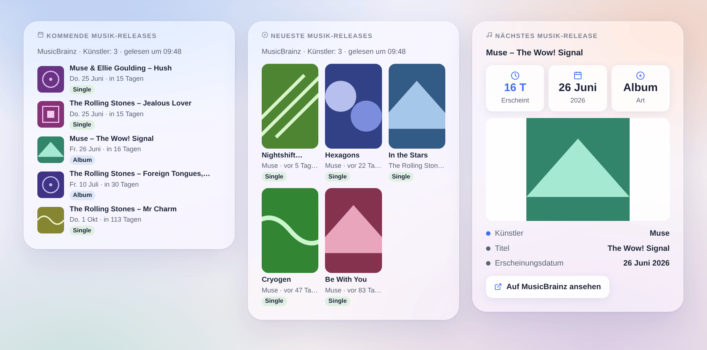

# MusicBrainz

## Überblick

Diese Integration bringt die **Neuerscheinungen der Künstler, denen Sie folgen**, in Gladys: Alben, EPs, Singles, Live-Alben und Compilations landen in einem **Kalender „Musik-Neuerscheinungen“** für jeden Benutzer, der die Integration aktiviert. Szenen können reagieren, wenn eine Veröffentlichung angekündigt wird, am Tag ihres Erscheinens (oder am Vortag oder eine Woche vorher) und wenn sich ihr Datum ändert, und drei Dashboard-Widgets zeigen samt Cover, was kommt und was gerade erschienen ist.

Die Veröffentlichungen stammen von [MusicBrainz](https://musicbrainz.org), der offenen Musik-Enzyklopädie, die von ihrer Community und der MetaBrainz Foundation gepflegt wird, über deren offizielle API. Weder Konto noch Schlüssel sind nötig. Die Cover stammen aus dem [Cover Art Archive](https://coverartarchive.org).

## Voraussetzungen

- Gladys Assistant **5.3.0** oder neuer (Kalender-Integrationen).
- Internetzugang.
- Optional: ein MusicBrainz-Konto mit einer öffentlichen Künstlersammlung, ein ListenBrainz-Profil oder ein Last.fm-Profil mit kostenlosem API-Schlüssel.

## Konfiguration

Geben Sie zuerst an, welchen Künstlern Sie folgen. Vier Wege, die sich ergänzen (höchstens 300 Künstler):

1. **Schaltfläche „Einem Künstler folgen“**: Geben Sie einen Namen ein, die Integration findet den Künstler auf MusicBrainz und sagt Ihnen, welchen sie übernommen hat. Bei Namensvettern (es gibt mehrere „Nirvana“) fügen Sie die Adresse der Künstlerseite auf musicbrainz.org ein oder die Kennung, die die Meldung auflistet. „Einem Künstler nicht mehr folgen“ entfernt einen; „Verfolgte Künstler auflisten“ zeigt alle mit ihrer Quelle.
2. **MusicBrainz-Sammlung**: die Adresse einer öffentlichen Künstlersammlung Ihres MusicBrainz-Kontos. Fügen Sie Künstler auf musicbrainz.org hinzu oder entfernen Sie sie, die Integration liest die Sammlung einmal täglich neu.
3. **ListenBrainz-Benutzername**: Ihren meistgehörten Künstlern wird gefolgt.
4. **Last.fm-Benutzername** und **Last.fm-API-Schlüssel**: Ihren meistgehörten Künstlern wird gefolgt. Der Schlüssel ist kostenlos und in einer Minute auf [last.fm/api](https://www.last.fm/api/account/create) erstellt.

| Feld                                   | Beschreibung                                                                                                                |
| -------------------------------------- | --------------------------------------------------------------------------------------------------------------------------- |
| Arten von Veröffentlichungen           | Standardmäßig Alben und EPs; Singles, Live-Alben, Compilations und Sonstige (Soundtracks, Remixe …) lassen sich hinzufügen. |
| MusicBrainz-Sammlung                   | Adresse (oder Kennung) einer öffentlichen Künstlersammlung. Optional.                                                       |
| ListenBrainz-Benutzername              | Optional. Öffentliche Statistiken, kein Schlüssel.                                                                          |
| Last.fm-Benutzername / -API-Schlüssel  | Optional. Der Schlüssel wird nur an Last.fm gesendet.                                                                       |
| Verfolgte meistgehörte Künstler        | 10, 20 (Standard), 30 oder 50, für ListenBrainz und Last.fm.                                                                |
| Hörzeitraum                            | Das Jahr (Last.fm: die letzten 12 Monate; ListenBrainz: das laufende Jahr, bis Ende Februar das vorige) oder seit Beginn.   |
| Lesen von MusicBrainz                  | Alle 3, 6 (Standard), 12 oder 24 Stunden.                                                                                   |
| Stunde des Auslösers „Erscheinungstag“ | Von 0 bis 23, Ortszeit (Standard: 9).                                                                                       |
| Sprache der Szenentexte                | Sprache der fertigen Sätze und der Meldungen der Schaltflächen. Automatisch: die Sprache des Dashboards.                    |

Speichern Sie und drücken Sie dann in **Meine Kalender** auf derselben Seite auf **Für mich aktivieren**. Jeder Benutzer, der den Kalender möchte, aktiviert die Integration für sich selbst. Die Liste der verfolgten Künstler ist für alle dieselbe.

## Verwendung

### Kalender

Jeder Benutzer erhält einen Kalender namens „Musik-Neuerscheinungen“ mit einem **ganztägigen Termin** pro Veröffentlichung, deren Tag bekannt ist: „Muse – The Wow! Signal“, ihre Art in der Beschreibung und ein Link zu ihrer Seite auf MusicBrainz. Der Kalender hält die Veröffentlichungen von 30 Tagen zurück bis zwei Jahre voraus. Ändert sich das Datum einer Veröffentlichung, zieht der Termin mit; eine Veröffentlichung, die MusicBrainz entfernt oder deren Künstler Sie nicht mehr folgen, verschwindet.

Eine für „2027“ oder „März 2027“ angekündigte Veröffentlichung hat noch keinen Tag: Sie steht in den Widgets und kommt in den Kalender, sobald ihr Tag bekannt ist.

Ein neuer Kalender ist **privat**. Schalten Sie in **Meine Kalender** die Option **Mit dem Haushalt teilen** ein, um ihn in den Szenen des Haushalts (und mit dem nativen Auslöser „Kalenderereignis steht bevor“) zu nutzen, oder schalten Sie **Diesen Kalender synchronisieren** aus, um ihn auszulassen.

### Dashboard-Widgets

- **Kommende Musik-Releases**: die nächsten 3, 5 oder 8 Veröffentlichungen mit Datum, verbleibender Zeit, einem Abzeichen für die Art und dem Cover. Tippen Sie auf eine Veröffentlichung für ihre Details und ihre MusicBrainz-Seite.
- **Neueste Musik-Releases**: die 6, 9 oder 12 neuesten Platten der letzten 30, 60 oder 90 Tage als Cover-Raster.
- **Nächstes Musik-Release**: der Countdown bis zur nächsten Veröffentlichung, ihr Datum, ihre Art und ihr großes Cover.

Jedes lässt sich in seinen Einstellungen auf bestimmte Arten von Veröffentlichungen beschränken. Ein Cover wird nur angezeigt, wenn das Cover Art Archive eines hat, was lange vor der Veröffentlichung selten ist.

### Szenen

Auslöser (Filter: Arten von Veröffentlichungen und der Name eines Künstlers genau so, wie MusicBrainz ihn schreibt):

- **MusicBrainz: Veröffentlichung angekündigt**: Eine neue Veröffentlichung eines verfolgten Künstlers ist auf MusicBrainz erschienen. Einem neuen Künstler zu folgen kündigt nichts an: nur, was danach erscheint.
- **MusicBrainz: Erscheinungstag**: Eine Veröffentlichung erscheint heute, morgen oder in einer Woche (in „Wann“ zu wählen), zur Stunde der Konfiguration. Nur für Veröffentlichungen, deren Tag bekannt ist.
- **MusicBrainz: Erscheinungsdatum geändert**: Das Datum einer kommenden Veröffentlichung wurde verschoben, vorgezogen oder präzisiert; `previous_date` enthält das alte.

Die Variablen: `full_title` („Muse – The Wow! Signal“), `title`, `artist`, `credit`, `kind` (album, ep, single, live, compilation, other), `kind_name`, `date`, `date_text`, `days`, `url`, `cover_url`, `text` (ein fertiger Satz), `release_id`.

Aktionen: **MusicBrainz: nächste Veröffentlichung** und **MusicBrainz: neueste Veröffentlichung** liefern eine Veröffentlichung (bestimmter Arten oder eines Künstlers): Titel, Künstler, Art, Datum, Tage bis dahin oder seither, Link, Cover-Adresse und einen fertigen Satz `text`.

Beispiele:

- Wenn **ein Album eines verfolgten Künstlers heute erscheint** → um 9 Uhr `{{triggerEvent.data.text}}` per Telegram senden.
- Wenn **eine Veröffentlichung angekündigt wird** → `{{triggerEvent.data.full_title}}, {{triggerEvent.data.date_text}}` und den Link `{{triggerEvent.data.url}}` senden.
- Jeden Freitag um 18 Uhr → **MusicBrainz: neueste Veröffentlichung**, dann Gladys ihren `text` sagen lassen.

### Transport

Nur Cloud. Die Kennungen der verfolgten Künstler gehen an MusicBrainz; die Cover werden aus dem Cover Art Archive geladen, wenn ein Dashboard sie zeigt; Ihr ListenBrainz- oder Last.fm-Benutzername geht nur an diesen Dienst, wenn Sie ihn angeben. Sonst verlässt nichts über Sie oder Ihr Zuhause Ihr Netzwerk.

## Fehlerbehebung

- **Der Kalender bleibt leer**: Prüfen Sie, ob Sie in Meine Kalender auf **Für mich aktivieren** gedrückt haben, ob mindestens einem Künstler gefolgt wird („Verfolgte Künstler auflisten“) und ob eine Veröffentlichung der gewählten Arten einen bekannten Tag hat. Viele Künstler haben nichts angekündigt.
- **Dem falschen Künstler wird gefolgt**: Mehrere Künstler tragen diesen Namen. Folgen Sie ihm nicht mehr und folgen Sie dann dem richtigen, indem Sie die Adresse seiner Seite auf musicbrainz.org einfügen.
- **„MusicBrainz ist überlastet“**: Die Server antworten unter Last mit „busy“. Die Integration versucht es einige Minuten später von selbst erneut; nichts geht verloren.
- **Quelle „Sammlung“: Sammlung nicht gefunden**: Die Sammlung muss öffentlich sein (auf musicbrainz.org bearbeiten) und Künstler enthalten, keine Veröffentlichungen.
- **Quelle „Last.fm“: der Last.fm-API-Schlüssel wird abgelehnt**: Prüfen Sie den auf last.fm/api erstellten Schlüssel. Ein Künstler, den Last.fm anders nennt als MusicBrainz, wird übersprungen.
- **Eine Veröffentlichung fehlt oder ihr Datum ist falsch**: MusicBrainz wird von seiner Community gepflegt; jeder kann auf musicbrainz.org eine Veröffentlichung hinzufügen oder korrigieren, und die Integration folgt beim nächsten Lesen. Bootlegs werden absichtlich ausgelassen, und die Neuauflage einer alten Platte ist keine Neuerscheinung.
- **Eine Veröffentlichung hat kein Cover**: Das Cover Art Archive hat noch keines; die Integration fragt jeden Tag erneut.
- **Die Szene „Erscheinungstag“ lief nicht**: Sie wird einmal ausgelöst, zur Stunde der Konfiguration, wenn Gladys zu dieser Zeit läuft; die Veröffentlichung braucht einen genauen Tag und eine verfolgte Art.

Geben Sie für einen Fehlerbericht die Versionen von Gladys und der Integration, die genutzten Künstlerquellen und die Zeilen des Tabs Protokolle der Integration an; im Entwicklermodus fügt `DEBUG=gladys-integration-sdk` die SDK-Protokolle hinzu.
