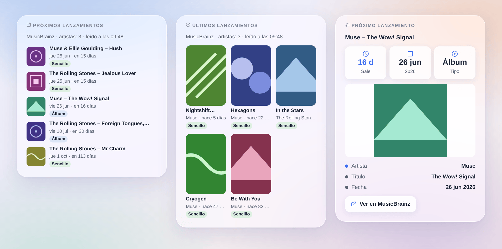

# MusicBrainz

## Presentación

Esta integración lleva a Gladys los **nuevos lanzamientos de los artistas que sigue**: álbumes, EP, sencillos, álbumes en directo y recopilatorios llegan a un **calendario «Lanzamientos musicales»** para cada usuario que activa la integración. Las escenas pueden reaccionar cuando se anuncia un lanzamiento, el día en que sale (o la víspera, o una semana antes) y cuando cambia su fecha, y tres widgets del panel muestran lo que viene y lo que acaba de salir, con las portadas.

Los lanzamientos proceden de [MusicBrainz](https://musicbrainz.org), la enciclopedia libre de la música mantenida por su comunidad y la MetaBrainz Foundation, mediante su API oficial. No hace falta cuenta ni clave. Las portadas proceden de [Cover Art Archive](https://coverartarchive.org).

## Requisitos

- Gladys Assistant **5.3.0** o posterior (integraciones de calendario).
- Acceso a internet.
- Opcional: una cuenta de MusicBrainz con una colección pública de artistas, un perfil de ListenBrainz o un perfil de Last.fm con una clave de API gratuita.

## Configuración

Indique primero los artistas que quiere seguir. Cuatro maneras, que se suman (300 artistas como máximo):

1. **Botón «Seguir a un artista»**: escriba un nombre; la integración encuentra al artista en MusicBrainz y le dice cuál ha elegido. Para un homónimo (hay varios «Nirvana»), pegue la dirección de la página del artista en musicbrainz.org, o el identificador que indica el mensaje. «Dejar de seguir a un artista» quita uno; «Listar los artistas seguidos» los muestra todos con su fuente.
2. **Colección de MusicBrainz**: la dirección de una colección pública de artistas de su cuenta de MusicBrainz. Añada o quite artistas en musicbrainz.org; la integración vuelve a leer la colección una vez al día.
3. **Usuario de ListenBrainz**: se sigue a sus artistas más escuchados.
4. **Usuario de Last.fm** y **Clave de API de Last.fm**: se sigue a sus artistas más escuchados. La clave es gratuita y se crea en un minuto en [last.fm/api](https://www.last.fm/api/account/create).

| Campo                                    | Descripción                                                                                                                        |
| ---------------------------------------- | ---------------------------------------------------------------------------------------------------------------------------------- |
| Tipos de lanzamientos                    | Álbumes y EP por defecto; se pueden añadir sencillos, álbumes en directo, recopilatorios y otros (bandas sonoras, remezclas…).     |
| Colección de MusicBrainz                 | Dirección (o identificador) de una colección pública de artistas. Opcional.                                                        |
| Usuario de ListenBrainz                  | Opcional. Estadísticas públicas, sin clave.                                                                                        |
| Usuario / clave de API de Last.fm        | Opcional. La clave solo se envía a Last.fm.                                                                                        |
| Artistas más escuchados seguidos         | 10, 20 (por defecto), 30 o 50, para ListenBrainz y Last.fm.                                                                        |
| Periodo de escucha                       | El año (Last.fm: los últimos 12 meses; ListenBrainz: el año en curso, el anterior hasta finales de febrero), o desde el principio. |
| Lectura de MusicBrainz                   | Cada 3, 6 (por defecto), 12 o 24 horas.                                                                                            |
| Hora del disparador «día de lanzamiento» | De 0 a 23, hora local (9 por defecto).                                                                                             |
| Idioma de los textos de las escenas      | Idioma de las frases hechas y de los mensajes de los botones. Automático: el idioma del panel.                                     |

Guarde y después, en **Mis calendarios** en la misma página, pulse **Activar para mí**. Cada usuario que quiera el calendario activa la integración para sí mismo. La lista de artistas seguidos es la misma para todos.

## Uso

### Calendario

Cada usuario obtiene un calendario llamado «Lanzamientos musicales», con un **evento de día completo** por cada lanzamiento cuyo día está anunciado: «Muse – The Wow! Signal», su tipo en la descripción y un enlace a su página en MusicBrainz. El calendario conserva los lanzamientos desde 30 días atrás hasta dos años por delante. Si cambia la fecha de un lanzamiento, el evento la sigue; un lanzamiento que MusicBrainz retira, o cuyo artista deja de seguir, desaparece.

Un lanzamiento anunciado para «2027» o «marzo de 2027» aún no tiene día: aparece en los widgets y entra en el calendario en cuanto se conoce su día.

Un calendario nuevo es **privado**. En **Mis calendarios**, active **Compartir con el hogar** para usarlo en las escenas del hogar (y con el disparador nativo «Se acerca un evento del calendario»), o desactive **Sincronizar este calendario** para dejarlo de lado.

### Widgets del panel

- **Próximos lanzamientos**: los 3, 5 u 8 próximos lanzamientos con su fecha, el tiempo que falta, una insignia para el tipo y la portada. Toque un lanzamiento para ver sus detalles y su página de MusicBrainz.
- **Últimos lanzamientos**: los 6, 9 o 12 últimos discos publicados en los últimos 30, 60 o 90 días, en cuadrícula de portadas.
- **Próximo lanzamiento**: la cuenta atrás hasta el próximo lanzamiento, su fecha, su tipo y su portada grande.

Cada uno puede limitarse a ciertos tipos de lanzamientos en sus ajustes. Una portada solo se muestra cuando Cover Art Archive tiene una, lo que es raro mucho antes del lanzamiento.

### Escenas

Disparadores (filtros: tipos de lanzamientos y el nombre de un artista exactamente como lo escribe MusicBrainz):

- **MusicBrainz: lanzamiento anunciado**: ha aparecido en MusicBrainz un nuevo lanzamiento de un artista seguido. Seguir a un artista nuevo no anuncia nada: solo lo que aparece después.
- **MusicBrainz: día de lanzamiento**: un lanzamiento sale hoy, mañana o dentro de una semana (se elige en «Cuándo»), a la hora de la configuración. Solo para los lanzamientos cuyo día se conoce.
- **MusicBrainz: fecha de lanzamiento modificada**: la fecha de un próximo lanzamiento se ha aplazado, adelantado o precisado; `previous_date` contiene la anterior.

Las variables: `full_title` («Muse – The Wow! Signal»), `title`, `artist`, `credit`, `kind` (album, ep, single, live, compilation, other), `kind_name`, `date`, `date_text`, `days`, `url`, `cover_url`, `text` (una frase hecha), `release_id`.

Acciones: **MusicBrainz: próximo lanzamiento** y **MusicBrainz: último lanzamiento** devuelven un lanzamiento (de ciertos tipos, o de un artista): título, artista, tipo, fecha, días que faltan o transcurridos, enlace, dirección de la portada y una frase hecha `text`.

Ejemplos:

- Cuando **un álbum de un artista seguido sale hoy** → enviar `{{triggerEvent.data.text}}` por Telegram a las 9:00.
- Cuando **se anuncia un lanzamiento** → enviar `{{triggerEvent.data.full_title}}, {{triggerEvent.data.date_text}}` y el enlace `{{triggerEvent.data.url}}`.
- Cada viernes a las 18:00 → **MusicBrainz: último lanzamiento**, y hacer que Gladys diga su `text`.

### Transporte

Solo nube. Los identificadores de los artistas seguidos van a MusicBrainz; las portadas se descargan de Cover Art Archive cuando un panel las muestra; su usuario de ListenBrainz o de Last.fm solo va a ese servicio, cuando lo indica. Nada más sobre usted o su hogar sale de su red.

## Solución de problemas

- **El calendario sigue vacío**: compruebe que ha pulsado **Activar para mí** en Mis calendarios, que se sigue al menos a un artista («Listar los artistas seguidos») y que algún lanzamiento de los tipos elegidos tiene un día conocido. Muchos artistas no tienen nada anunciado.
- **Se siguió al artista equivocado**: varios artistas comparten ese nombre. Deje de seguirlo y siga al correcto pegando la dirección de su página en musicbrainz.org.
- **«MusicBrainz está saturado»**: sus servidores responden «busy» cuando están cargados. La integración lo reintenta por sí sola unos minutos después; no se pierde nada.
- **Fuente «colección»: colección no encontrada**: la colección debe ser pública (edítela en musicbrainz.org) y contener artistas, no lanzamientos.
- **Fuente «Last.fm»: la clave de API de Last.fm es rechazada**: compruebe la clave, creada en last.fm/api. Un artista al que Last.fm llama de otro modo que MusicBrainz se omite.
- **Falta un lanzamiento o su fecha es errónea**: MusicBrainz lo edita su comunidad; cualquiera puede añadir o corregir un lanzamiento en musicbrainz.org, y la integración lo recoge en su próxima lectura. Los bootlegs se descartan a propósito, y la reedición de un disco antiguo no es una novedad.
- **Un lanzamiento no tiene portada**: Cover Art Archive aún no tiene ninguna; la integración vuelve a preguntar cada día.
- **La escena «día de lanzamiento» no se ejecutó**: se dispara una vez, a la hora de la configuración, si Gladys está en marcha en ese momento; el lanzamiento necesita un día exacto y un tipo seguido.

Para un informe de error, indique las versiones de Gladys y de la integración, las fuentes de artistas que usa y las líneas de la pestaña Registros de la integración; en modo desarrollador, `DEBUG=gladys-integration-sdk` añade los registros del SDK.
