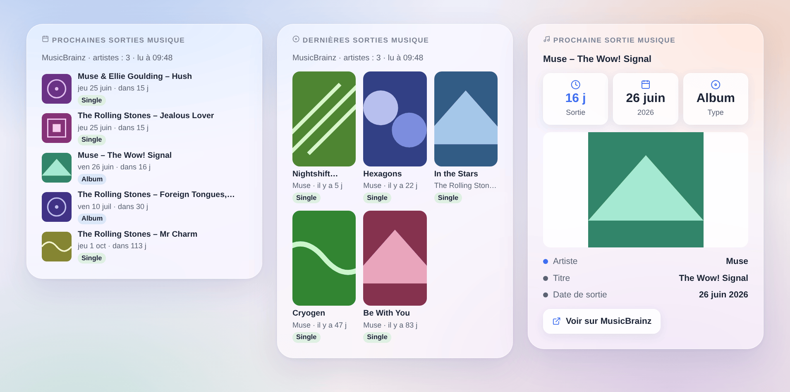

# MusicBrainz

## Présentation

Cette intégration amène dans Gladys les **nouvelles sorties des artistes que vous suivez** : albums, EP, singles, albums live et compilations arrivent dans un **calendrier « Sorties musicales »** pour chaque utilisateur qui active l’intégration. Les scènes peuvent réagir quand une sortie est annoncée, le jour où elle paraît (ou la veille, ou une semaine avant) et quand sa date change, et trois widgets de tableau de bord montrent ce qui arrive et ce qui vient de sortir, avec les pochettes.

Les sorties viennent de [MusicBrainz](https://musicbrainz.org), l’encyclopédie libre de la musique tenue par sa communauté et la MetaBrainz Foundation, par son API officielle. Ni compte ni clé ne sont nécessaires. Les pochettes viennent de la [Cover Art Archive](https://coverartarchive.org).

## Prérequis

- Gladys Assistant **5.3.0** ou plus récent (intégrations de type calendrier).
- Un accès à Internet.
- Facultatif : un compte MusicBrainz avec une collection publique d’artistes, un profil ListenBrainz, ou un profil Last.fm avec une clé d’API gratuite.

## Configuration

Indiquez d’abord les artistes à suivre. Quatre façons, qui se cumulent (300 artistes au maximum) :

1. **Bouton « Suivre un artiste »** : saisissez un nom, l’intégration trouve l’artiste sur MusicBrainz et vous dit lequel elle a retenu. Pour un homonyme (il existe plusieurs « Nirvana »), collez l’adresse de la page de l’artiste sur musicbrainz.org, ou l’identifiant indiqué dans le message. « Ne plus suivre un artiste » en retire un ; « Lister les artistes suivis » les affiche tous avec leur source.
2. **Collection MusicBrainz** : l’adresse d’une collection publique d’artistes de votre compte MusicBrainz. Ajoutez ou retirez des artistes sur musicbrainz.org, l’intégration relit la collection une fois par jour.
3. **Nom d’utilisateur ListenBrainz** : vos artistes les plus écoutés sont suivis.
4. **Nom d’utilisateur Last.fm** et **clé d’API Last.fm** : vos artistes les plus écoutés sont suivis. La clé est gratuite et se crée en une minute sur [last.fm/api](https://www.last.fm/api/account/create).

| Champ                                   | Description                                                                                                                        |
| --------------------------------------- | ---------------------------------------------------------------------------------------------------------------------------------- |
| Types de sorties                        | Albums et EP par défaut ; singles, albums live, compilations et autres (bandes originales, remix…) peuvent être ajoutés.           |
| Collection MusicBrainz                  | Adresse (ou identifiant) d’une collection publique d’artistes. Facultatif.                                                         |
| Nom d’utilisateur ListenBrainz          | Facultatif. Statistiques publiques, sans clé.                                                                                      |
| Nom d’utilisateur / clé d’API Last.fm   | Facultatif. La clé n’est envoyée qu’à Last.fm.                                                                                     |
| Artistes les plus écoutés suivis        | 10, 20 (par défaut), 30 ou 50, pour ListenBrainz et Last.fm.                                                                       |
| Période d’écoute                        | L’année (Last.fm : les 12 derniers mois ; ListenBrainz : l’année en cours, la précédente jusqu’à fin février), ou depuis le début. |
| Lecture de MusicBrainz                  | Toutes les 3, 6 (par défaut), 12 ou 24 heures.                                                                                     |
| Heure du déclencheur « jour de sortie » | De 0 à 23, heure locale (9 par défaut).                                                                                            |
| Langue des textes des scènes            | Langue des phrases toutes faites et des messages des boutons. Automatique : la langue du tableau de bord.                          |

Enregistrez puis, dans **Mes calendriers** sur la même page, appuyez sur **Activer pour moi**. Chaque utilisateur qui veut le calendrier active l’intégration pour lui-même. La liste des artistes suivis est la même pour tout le monde.

## Utilisation

### Calendrier

Chaque utilisateur obtient un calendrier nommé « Sorties musicales », avec un **événement d’une journée** par sortie dont le jour est annoncé : « Muse – The Wow! Signal », son type dans la description et un lien vers sa page sur MusicBrainz. Le calendrier garde les sorties de 30 jours en arrière à deux ans en avant. Une sortie dont la date change suit ; une sortie que MusicBrainz retire, ou dont vous ne suivez plus l’artiste, disparaît.

Une sortie annoncée pour « 2027 » ou « mars 2027 » n’a pas encore de jour : elle figure dans les widgets et rejoint le calendrier dès que son jour est connu.

Un nouveau calendrier est **privé**. Dans **Mes calendriers**, activez **Partager avec le foyer** pour l’utiliser dans les scènes du foyer (et avec le déclencheur natif « Un évènement dans le calendrier arrive »), ou désactivez **Synchroniser ce calendrier** pour le laisser de côté.

### Widgets du tableau de bord

- **Prochaines sorties musique** : les 3, 5 ou 8 prochaines sorties avec leur date, le délai qui reste, un badge pour le type et la pochette. Touchez une sortie pour voir son détail et sa page MusicBrainz.
- **Dernières sorties musique** : les 6, 9 ou 12 derniers disques parus ces 30, 60 ou 90 derniers jours, en grille de pochettes.
- **Prochaine sortie musique** : le compte à rebours avant la prochaine sortie, sa date, son type et sa grande pochette.

Chacun peut être limité à certains types de sorties dans ses réglages. Une pochette ne s’affiche que si la Cover Art Archive en a une, ce qui est rare longtemps avant la sortie.

### Scènes

Déclencheurs (filtres : types de sorties, et le nom d’un artiste exactement comme MusicBrainz l’écrit) :

- **MusicBrainz : sortie annoncée** : une nouvelle sortie d’un artiste suivi est apparue sur MusicBrainz. Suivre un nouvel artiste n’annonce rien : seul ce qui apparaît ensuite le fait.
- **MusicBrainz : jour de sortie** : une sortie a lieu aujourd’hui, demain ou dans une semaine (à choisir dans « Quand »), à l’heure de la configuration. Seulement pour les sorties dont le jour est connu.
- **MusicBrainz : date de sortie modifiée** : la date d’une sortie à venir a été repoussée, avancée ou précisée ; `previous_date` contient l’ancienne.

Les variables : `full_title` (« Muse – The Wow! Signal »), `title`, `artist`, `credit`, `kind` (album, ep, single, live, compilation, other), `kind_name`, `date`, `date_text`, `days`, `url`, `cover_url`, `text` (une phrase toute faite), `release_id`.

Actions : **MusicBrainz : prochaine sortie** et **MusicBrainz : dernière sortie** donnent une sortie (de certains types, ou d’un artiste) : titre, artiste, type, date, jours avant ou depuis, lien, adresse de la pochette et une phrase toute faite `text`.

Exemples :

- Quand **un album d’un artiste suivi sort aujourd’hui** → envoyer `{{triggerEvent.data.text}}` sur Telegram à 9 h.
- Quand **une sortie est annoncée** → envoyer `{{triggerEvent.data.full_title}}, {{triggerEvent.data.date_text}}` et le lien `{{triggerEvent.data.url}}`.
- Chaque vendredi à 18 h → **MusicBrainz : dernière sortie**, puis faire dire son `text` à Gladys.

### Transport

Cloud uniquement. Les identifiants des artistes suivis partent vers MusicBrainz ; les pochettes sont téléchargées depuis la Cover Art Archive quand un tableau de bord les affiche ; votre nom d’utilisateur ListenBrainz ou Last.fm ne part que vers ce service, quand vous le renseignez. Rien d’autre sur vous ou votre maison ne quitte votre réseau.

## Dépannage

- **Le calendrier reste vide** : vérifiez que vous avez appuyé sur **Activer pour moi** dans Mes calendriers, qu’au moins un artiste est suivi (« Lister les artistes suivis ») et qu’une sortie des types choisis a un jour connu. Beaucoup d’artistes n’ont rien d’annoncé.
- **Le mauvais artiste a été suivi** : plusieurs artistes portent ce nom. Cessez de le suivre, puis suivez le bon en collant l’adresse de sa page sur musicbrainz.org.
- **« MusicBrainz est surchargé »** : ses serveurs répondent « busy » quand ils sont chargés. L’intégration réessaie d’elle-même quelques minutes plus tard ; rien n’est perdu.
- **Source « collection » : collection introuvable** : la collection doit être publique (modifiez-la sur musicbrainz.org) et contenir des artistes, pas des parutions.
- **Source « Last.fm » : la clé d’API Last.fm est refusée** : vérifiez la clé, créée sur last.fm/api. Un artiste que Last.fm nomme autrement que MusicBrainz est ignoré.
- **Une sortie manque ou sa date est fausse** : MusicBrainz est rédigé par sa communauté ; chacun peut ajouter ou corriger une sortie sur musicbrainz.org, et l’intégration suit à sa prochaine lecture. Les bootlegs sont écartés volontairement, et la réédition d’un ancien disque n’est pas une nouveauté.
- **Une sortie n’a pas de pochette** : la Cover Art Archive n’en a pas encore ; l’intégration redemande chaque jour.
- **La scène « jour de sortie » ne s’est pas lancée** : elle se déclenche une fois, à l’heure de la configuration, si Gladys tourne à ce moment-là ; la sortie doit avoir un jour exact et un type suivi.

Pour un rapport de bug, donnez les versions de Gladys et de l’intégration, les sources d’artistes utilisées et les lignes de l’onglet Journaux de l’intégration ; en mode développeur, `DEBUG=gladys-integration-sdk` ajoute les journaux du SDK.
